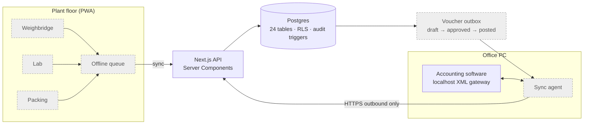
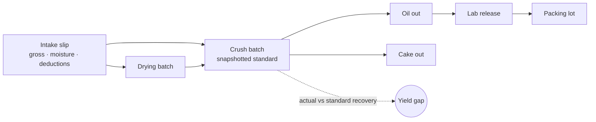

# Mill Yield & Traceability System

**Case study (in progress).** A yield-tracking and traceability system for a three-plant edible-oil manufacturer in South India. It covers everything physical (weighments, drying, crushing, lab results, packing), and it's designed to sit alongside the company's existing accounting software rather than replace it.

> This repository is a write-up, not the source. The code belongs to the client and stays private.
> I'm happy to give a live walkthrough of the architecture and code in an interview.

| | |
|---|---|
| **Role** | Sole engineer: specification, data model, implementation |
| **Status** | Foundation milestone (M0) complete. Yield and traceability milestones in progress |
| **Stack** | Next.js 15 · TypeScript (strict) · Drizzle ORM · PostgreSQL (Supabase) · Supabase Auth (email OTP) · Vitest · Vercel |
| **Size** | 24-table schema · hand-written audit and RLS hardening migration · unit and database integration tests |

---

## The problem

The money this business loses goes missing **between raw material entering the expeller and oil leaving it**. Intake slips, crush registers, lab books and the accounting system all live in different places. Nobody can line them up to see where recovery falls short. At this scale, a 1% shortfall in oil recovery is worth several lakh rupees per plant per month.

The system has one job: **make that leak visible.** Every feature traces back to it.

## Design principles I set

- **The accounting system owns money, and this system owns physical reality.** Ledgers, vouchers, GST and statements stay in the accounting software. This system owns weighments, drying, crush batches, yield, lab results, packing lots and traceability.
- **Nothing is written to the books silently.** Every outbound voucher is a queued draft that a human must approve before it's posted. The database enforces this, not just the code.
- **Offline tolerance is a requirement.** The weighbridge and mill floor have unreliable connectivity, so the data-entry screens are designed to queue locally and sync.
- **Regional-language names must round-trip exactly.** Party names in the local script have to survive the accounting system's non-UTF-8 XML gateway. This is handled explicitly and tested.

## What's built (Milestone 0: foundation)

- **The complete 24-table schema up front,** including tables for later milestones, so the schema is settled in week one rather than migrated in week four.
- **Business rules encoded as database constraints,** not just application checks:
  - a voucher can't reach `posted` without an `approved_by`
  - a crush batch draws from a drying batch *or* an intake slip, never both and never neither
  - net weight can never exceed gross weight (a deduction can't add weight)
  - a lab release can't exist without the user who released it
  - a stock transfer can't go from a plant to itself
- **History-preserving snapshots.** Standard recovery % and oil density are copied onto each crush batch when it's charged. Revising a standard later can't silently rewrite how past batches were judged.
- **An audit trigger and row-level security on every table,** applied by a repeatable hardening migration. A `db:check` script fails loudly if any table is missing either, so forgetting is a visible error, not a silent hole in a legal record.
- **Money and quantities never pass through a JavaScript `number`.** All arithmetic is decimal-safe, with tests that enforce it.
- **Passwordless email OTP auth** with unknown emails rejected outright. Seven roles (owner, plant manager, weighbridge, lab, packing, accounts, viewer) are scoped per plant, and a missing permission gets a proper 403.
- **CI-equivalent local verification** (`pnpm verify`) runs typecheck, lint, unit tests, a production build against placeholder credentials, both migrations, RLS/audit assertions, a twice-run seed to prove idempotency, and the integration suite, all on a throwaway Postgres.

---

## Target architecture

The shaded parts (offline floor app, sync agent and voucher outbox flow) are designed and specified but come in later milestones.

### The flow being made visible

---

## Engineering notes

- **The accounting gateway has no authentication,** so it must never be exposed. The sync agent runs on the same machine, talks to the gateway on localhost, and only ever pushes outbound over HTTPS. Nothing connects in from outside.
- **Spec-driven milestones.** Each milestone has written acceptance criteria (for example, "the anon key can read nothing" and "every mutation produces exactly one audit row"), and each one is verified by a test or a database check, not by eye.

---

*Built by [Fawas Koya](https://github.com/fawaskoya). Client details are anonymized.*
